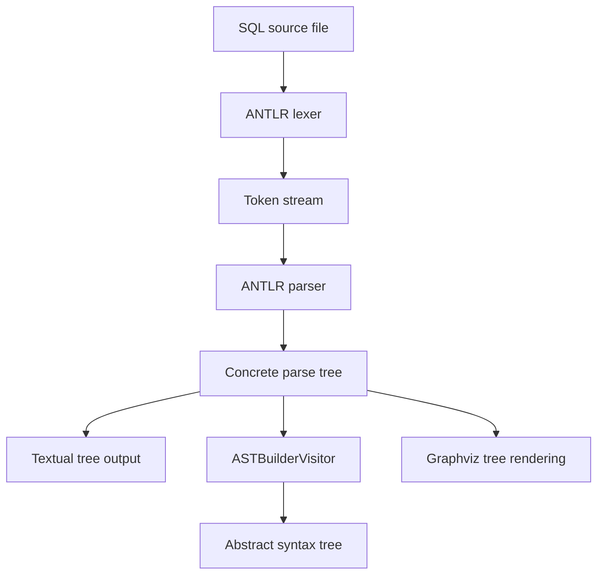

<div align="center">

# ANTLR SQL Compiler

**A Python-based SQL language analysis project built with ANTLR4, featuring custom grammar definitions, parse-tree inspection, abstract syntax tree construction, and visualization.**


</div>

## Overview

**ANTLR SQL Compiler** is an educational compiler-construction project that demonstrates how SQL source text can be **tokenized, parsed, transformed into an abstract syntax tree (AST), and visualized**. It uses custom ANTLR4 lexer and parser grammars with Python target code, plus a visitor-based AST builder.

Although the repository is named a *compiler*, the visible entry points focus on **SQL language analysis**, rather than executing SQL against a database or producing machine code.

## Key Features

- **Custom SQL lexer and parser grammars** in ANTLR4 (`SqlLexer.g4` and `SqlParser.g4`).
- **Tokenization and syntax parsing** with the ANTLR4 Python runtime.
- **Multiple SQL statement families:** the grammar includes DML (`SELECT`, `INSERT`, `UPDATE`, `DELETE`) and DDL (`CREATE`, `ALTER`, `DROP`, and related operations).
- **More advanced grammar constructs:** joins, filters, grouping, ordering, common table expressions, cursors, and conditional blocks are represented in the parser grammar.
- **Parse-tree inspection** as a textual tree.
- **AST construction** using a dedicated visitor under `expression/core`.
- **Graphviz visualization** of an ANTLR parse tree.
- **Sample SQL inputs** for exploring supported syntax.

> **Scope note:** A grammar rule indicates intended syntax coverage; it does not guarantee every supported-looking SQL statement has been tested end-to-end or mapped into the AST. This is a custom SQL dialect subset, not a drop-in replacement for a database SQL engine.

## Processing Pipeline



### Lexical Analysis

`SqlLexer.g4` defines tokens for the SQL keywords, operators, identifiers, literals, and punctuation recognized by the language.

### Syntax Analysis

`SqlParser.g4` defines the language structure. Its top-level entry rule is **`sql_script`**, permitting a sequence of statements and `GO` separators.

### AST Construction

`test_sql.py` parses an input file, prints the ANTLR parse tree, and applies **`ASTBuilderVisitor`** to construct and print a higher-level AST. The AST-related implementation is organized under `expression/core`.

### Parse-Tree Visualization

`test tree.py` traverses the ANTLR parse tree and uses **Graphviz** to create a diagram. Its default source file is `input.sql`, and it renders a PNG using the output stem `sql_tree`.

## Technology Stack

| Component | Technology | Purpose |
| --- | --- | --- |
| Language | Python | Scripts, AST visitor, generated bindings |
| Grammar definition | ANTLR4 (`.g4`) | Lexical and syntax rules |
| Parser runtime | `antlr4-python3-runtime` | Reading and parsing SQL |
| Visualization | Graphviz + Python `graphviz` | Parse-tree diagrams |
| Inputs | SQL (`.sql`) | Examples and experimentation |

## Getting Started

### Prerequisites

- Python 3 and `pip`
- Graphviz executable installed and available on your system `PATH` **for tree visualization**
- Java and the ANTLR4 tool **only if you intend to regenerate the parser bindings**

### 1. Clone the Repository

```bash
git clone https://github.com/MohammedAbdelkarem/Antlr_SQL_Compiler.git
cd Antlr_SQL_Compiler
```

### 2. Create a Virtual Environment

```bash
python -m venv .venv
source .venv/bin/activate       # Linux / macOS
# .venv\Scripts\activate      # Windows PowerShell or CMD
```

### 3. Install Python Dependencies

```bash
python -m pip install antlr4-python3-runtime graphviz
```

> The repository includes generated parser files but does not expose a pinned requirements manifest at its root. If ANTLR runtime version errors occur, use a Python runtime matching the ANTLR version used to generate the checked-in files, or regenerate those files with a compatible ANTLR4 tool/runtime pair.

### 4. Parse SQL and Print the AST

The main inspection script reads **`input.sql`** from the current working directory:

```bash
python test_sql.py
```

The script is designed to output a **textual parse tree** and a **formatted abstract syntax tree**.

To try another query, edit `input.sql` or adjust the file name inside `test_sql.py`.

### 5. Generate a Parse-Tree Image (Optional)

First install the system Graphviz package and ensure the `dot` executable can be found:

```bash
dot -V
```

Then run:

```bash
python "test tree.py"
```

This uses `input.sql` and produces a Graphviz-rendered PNG (typically `sql_tree.png`).

> **Portability note:** `test tree.py` appends `C:\Program Files\Graphviz\bin` to `PATH`, a Windows-specific location. On Linux/macOS, install Graphviz normally and make sure its executable directory is on your existing `PATH`.

## SQL Grammar Coverage

The grammar defines syntax for the following major categories:

| Category | Examples |
| --- | --- |
| Data queries | `SELECT`, `DISTINCT`, `TOP`, joins, `WHERE`, `GROUP BY`, `HAVING`, `ORDER BY`, pagination |
| Data modifications | `INSERT`, `UPDATE`, `DELETE` |
| Schema and database definitions | `CREATE`, `ALTER`, `DROP`, `TRUNCATE`, `USE` |
| Other language constructs | Common table expressions, cursors, conditional blocks, `GO` |

Support varies by statement form. Refer to [`SqlParser.g4`](./SqlParser.g4) and [`SqlLexer.g4`](./SqlLexer.g4) for the authoritative syntax.

## Repository Structure

```text
Antlr_SQL_Compiler/
├── expression/                # AST-related implementation
│   └── core/                 # ASTBuilderVisitor and AST node components
├── SqlLexer.g4               # ANTLR lexer grammar
├── SqlParser.g4              # ANTLR parser grammar
├── SqlLexer.py               # Generated Python lexer
├── SqlParser.py              # Generated Python parser
├── SqlParserListener.py      # Generated parse-tree listener
├── SqlParserVisitor.py       # Generated parse-tree visitor
├── input.sql                 # Example SQL script
├── input2.sql                # Additional SQL input
├── input3.sql                # Additional SQL input
├── test_sql.py               # Parse-tree and AST inspection
├── test tree.py              # Graphviz parse-tree rendering
└── .gitignore
```

## Learning Objectives

This project showcases fundamental compiler-development concepts, including **lexical analysis**, **context-free grammars**, **parser generation**, **concrete versus abstract syntax trees**, and the **visitor design pattern**.

## Potential Improvements

- Add a pinned dependency manifest and reproducible setup instructions.
- Create automated valid/invalid SQL grammar tests and AST visitor tests.
- Provide an input-file command-line argument instead of hardcoding `input.sql`.
- Replace the Windows-specific Graphviz path with cross-platform configuration.
- Improve syntax and semantic error reporting.
- Document the exact SQL dialect subset and AST coverage.
- Add sample screenshots of generated parse trees.

## Authors

Developed by:

- **[Alaa Daloo](https://github.com/AlaaDaloo)**
- **[Mohammed Abdelkarem](https://github.com/MohammedAbdelkarem)**

## Contributing

Issues and pull requests that improve grammar coverage, test cases, error reporting, and project documentation are welcome. Include representative SQL inputs and expected outputs when reporting a parser bug.

## License

No license file was visible in the reviewed repository root. Unless the authors publish a license, do not assume that the code is licensed for unrestricted reuse or redistribution.

---

<div align="center">
<sub>Exploring compiler design through SQL parsing and syntax-tree construction.</sub>
</div>
